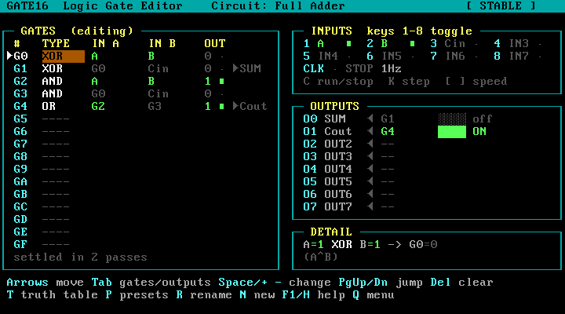

# GATE16 — 부팅 CD용 16게이트 논리회로 에디터

PC를 CD로 부팅하면 바로 실행되는 **논리 게이트 에디터/시뮬레이터**입니다.
운영체제 설치 없이, 하드디스크를 건드리지 않고, 리눅스 커널 위에서 이 프로그램 하나만 동작합니다.

- 게이트 슬롯 **16개 (G0~GF)**: BUF, NOT, AND, OR, NAND, NOR, XOR, XNOR
- 입력 스위치 8개 (키보드 `1`~`8`), 클럭(CLK), 상수 0/1
- 출력 LED 8개
- 모든 게이트 입력은 다른 게이트 출력(자기 자신 포함)에 연결 가능 → **래치·플립플롭 같은 피드백 회로도 동작**
- 실시간 시뮬레이션, 발진(oscillation) 감지, 진리표 자동 생성, 불 대수식 표시
- 예제 회로: 반가산기, 전가산기, SR 래치, D 래치, 2:1 MUX, NAND로 만든 XOR, 2비트 비교기, 클럭 2분주기



## 1. ISO 파일

굽기용 이미지: **[`dist/gate16.iso`](dist/gate16.iso)** (약 30MB, SHA-256은 `dist/gate16.iso.sha256`)

## 2. CD 굽기

CD-R / CD-RW (700MB) 아무거나 쓰면 됩니다. "데이터 파일로 복사"가 아니라 **"디스크 이미지 굽기"** 로 구워야 합니다.

| OS | 방법 |
|---|---|
| Windows 10/11 | `gate16.iso` 우클릭 → **디스크 이미지 굽기** → 드라이브 선택 → 굽기 |
| macOS | 터미널에서 `hdiutil burn gate16.iso` |
| Linux | `xorriso -as cdrecord -v dev=/dev/sr0 -eject gate16.iso` |

CD 드라이브가 없으면 같은 ISO를 **USB 메모리**에 써도 똑같이 부팅됩니다
(Rufus는 "DD 이미지 모드", balenaEtcher, 또는 리눅스 `sudo dd if=gate16.iso of=/dev/sdX bs=4M conv=fsync`).

## 3. 부팅

1. CD를 넣고 PC를 켜면서 **부팅 메뉴 키**를 연타합니다.

   | 마더보드/제조사 | 부팅 메뉴 키 |
   |---|---|
   | ASUS | F8 |
   | MSI | F11 |
   | GIGABYTE | F12 |
   | ASRock | F11 |
   | Dell / Lenovo | F12 |
   | HP | F9 |
   | 삼성 / LG 노트북 | F10 / F10 |

2. CD 드라이브(`UEFI: ...` 항목을 우선 추천)를 선택합니다.
3. GRUB 메뉴가 뜨고 5초 후 자동으로 **GATE16 Logic Gate Editor** 가 시작됩니다.

부팅이 끝나면 프로그램 전체가 메모리(RAM)에 올라가므로 실행 중에는 CD를 꺼내도 됩니다.
종료는 `Q` → `P` (전원 끄기) 또는 `B` (재부팅).

## 4. 마더보드 호환성

특정 보드 하나가 아니라 **일반 PC 메인보드 전반**에서 부팅되도록 만들었습니다.

| 항목 | 지원 |
|---|---|
| CPU | 64비트 x86 (Intel / AMD, 2008년 이후 대부분) |
| 펌웨어 | **레거시 BIOS(CSM)** 와 **UEFI** 모두 |
| Secure Boot | **켜진 상태에서도 부팅** (Microsoft 서명 shim → Canonical 서명 GRUB/커널) |
| 키보드 | PS/2, USB (USB 3.x xHCI / 2.0 EHCI / 1.1 OHCI·UHCI 컨트롤러) |
| 그래픽 | GPU 드라이버 없이 펌웨어 화면(VGA 텍스트 / UEFI GOP)을 사용 → 내장·외장 그래픽 모두 동작 |
| 메모리 | 512MB 이상 |
| 화면 | 고해상도 모니터에서는 큰 글꼴(16x32)로 자동 전환 |

미지원: ARM 보드(라즈베리파이 등), 32비트 전용 CPU, Apple Silicon Mac.

> 사용하시는 **메인보드 모델명**(예: `ASUS PRIME B760M-A`)을 알려주시면 그 보드의 칩셋·키보드 컨트롤러·펌웨어 특성에 맞춰 더 조정해 드릴 수 있습니다.

## 5. 사용법

화면 UI는 영어입니다 (리눅스 기본 콘솔 글꼴에 한글 글리프가 없기 때문).

| 키 | 동작 |
|---|---|
| `↑` `↓` `←` `→` | 게이트 / 칸(TYPE · IN A · IN B) 이동 |
| `Tab` | 게이트 표 ↔ 출력 LED 표 전환 |
| `Space` `+` / `Backspace` `-` | 선택한 칸의 값 다음 / 이전 |
| `PgUp` / `PgDn` | 값 8칸씩 건너뛰기 |
| `Del` | 게이트/출력 지우기 |
| `1` ~ `8` | 입력 스위치 IN0~IN7 켜기/끄기 |
| `C` / `K` / `[` `]` | 클럭 실행·정지 / 한 스텝 / 속도 (0.5~8Hz) |
| `T` | 진리표 |
| `P` | 예제 회로 불러오기 |
| `R` | 회로·입력·출력 이름 바꾸기 |
| `N` | 새 회로 |
| `H` / `F1` | 도움말 |
| `Q` | 메뉴 (계속 / 리눅스 쉘 / 재부팅 / 전원 끄기) |

**회로 만드는 예 (AND 게이트 하나):**
`N`(새 회로) → G0의 TYPE에서 `Space` 3번(AND) → 입력은 자동으로 IN0, IN1 연결 →
`Tab`으로 출력 표 이동 → O0에서 `Space`를 눌러 `G0` 선택 → `1`, `2` 를 눌러 LED가 켜지는지 확인.

## 6. 문제 해결

| 증상 | 해결 |
|---|---|
| CD로 부팅이 안 됨 | BIOS 설정에서 부팅 순서에 CD/DVD 추가, 또는 부팅 메뉴 키 사용 |
| "Secure Boot violation" | 거의 없지만 발생 시 BIOS에서 Secure Boot 끄기 |
| 화면이 검게 멈춤 | GRUB 메뉴에서 **safe graphics** 항목 선택 |
| 키보드가 안 먹음 | 키보드를 USB 2.0 포트(검은색)나 PS/2 포트에 연결, BIOS의 *USB Legacy Support* 켜기 |
| 원인 확인 | GRUB 메뉴의 **Linux shell first** 로 부팅 → `dmesg`, `lsmod` 확인 후 `exit` 하면 에디터 실행 |

## 7. 직접 빌드하기

Ubuntu 24.04에서:

```sh
sudo apt-get install build-essential grub-pc-bin grub-efi-amd64-bin grub-common \
  grub-efi-amd64-signed shim-signed xorriso mtools dosfstools busybox-static zstd kmod cpio
./build.sh                 # → out/gate16.iso
```

Docker로:

```sh
docker run --rm -v "$PWD":/src -w /src ubuntu:24.04 bash -c '
  apt-get update && DEBIAN_FRONTEND=noninteractive apt-get install -y build-essential \
  grub-pc-bin grub-efi-amd64-bin grub-common grub-efi-amd64-signed shim-signed xorriso \
  mtools dosfstools busybox-static zstd kmod cpio && ./build.sh'
```

굽기 전에 QEMU로 시험해 볼 수 있습니다 (`apt-get install qemu-system-x86 ovmf`):

```sh
scripts/run-qemu.sh          # 레거시 BIOS
scripts/run-qemu.sh uefi     # UEFI
scripts/run-qemu.sh secure   # UEFI + Secure Boot
```

시뮬레이터 자체 검사: `gcc -static -o gate16 src/gate16.c && ./gate16 --selftest`

## 구조

```
src/gate16.c        에디터/시뮬레이터 (C, 외부 라이브러리 없음, static 빌드)
rootfs/init         부팅 후 첫 프로세스: 드라이버 로드 → 에디터 실행/재시작
rootfs/etc/         mdev(핫플러그 드라이버 로드), 쉘 설정
boot/grub.cfg       BIOS/UEFI 공용 부팅 메뉴
build.sh            커널·BusyBox·서명된 부트로더를 모아 하이브리드 ISO 생성
scripts/run-qemu.sh QEMU 테스트 실행
dist/gate16.iso     빌드된 이미지
```

부팅 흐름: 펌웨어 → GRUB (BIOS: El Torito / UEFI: shim → 서명된 GRUB) → Ubuntu 6.8 커널 → initramfs(BusyBox + gate16) → `tty1`에서 GATE16 실행.
